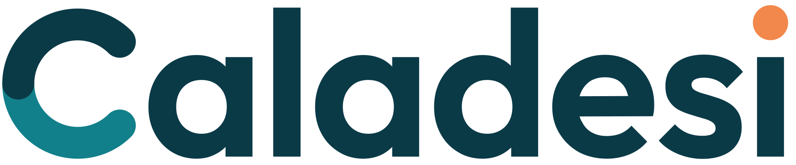

<h1 align="center">
  <picture>
    <source media="(prefers-color-scheme: dark)" srcset="branding/png/wordmark-on-dark-2000.png">
    
  </picture>
</h1>

Caladesi is a toy .NET language with TypeScript syntax. It has no compelling reason to exist, and I probably wouldn't use it
for professional work. The point is to explore language design, compiler construction, and .NET interoperability. Most of
this project was written by AI agents.

Source files are `.cala`; the compiler emits IL directly (it is not a transpiler), so Caladesi assemblies are ordinary
.NET assemblies that interoperate with C# and other .NET languages in both directions.

```ts
import { List } from "System.Collections.Generic";

type Point = { x: int; y: int };

class Shape {
  constructor(public readonly name: string) {}
  area(): double { return 0; }
}

async function main(args: string[]): Task<int> {
  const points: List<Point> = [{ x: 1, y: 2 }, { x: 3, y: 4 }];
  for (const p of points) Console.WriteLine(`${p.x},${p.y}`);
  await Task.Delay(10);
  return 0;
}
```

## Try it

Requires .NET 10 or later.

```sh
dotnet new install Caladesi.Templates  # install the templates from NuGet.org
dotnet new calaconsole -o hello
cd hello && dotnet run
```

A project file is a normal SDK-style project that uses the Caladesi SDK:

```xml
<Project Sdk="Caladesi.Sdk/1.0.0"> <!-- x-release-please-version -->
  <PropertyGroup>
    <OutputType>Exe</OutputType>
    <TargetFramework>net10.0</TargetFramework>
  </PropertyGroup>
</Project>
```

`dotnet build/run/test/pack/publish` work as usual. Caladesi projects can reference C# projects and NuGet packages and the other way round.

The language is described in [SPEC.md](SPEC.md); design decisions are in [DECISIONS.md](DECISIONS.md).

## Repository layout

| Path | What |
|---|---|
| `src/Caladesi.Compiler` | lexer, parser, symbols, binder, lowering, IL/PDB emit, semantic model, formatter (AOT/trim compatible) |
| `src/Caladesi.Cli` | `calac`, the command-line compiler |
| `src/Caladesi.Runtime` | runtime support (union types, attributes) |
| `src/Caladesi.Build.Tasks` | the MSBuild task that runs `calac` |
| `src/Caladesi.Sdk` | the `Caladesi.Sdk` MSBuild SDK package |
| `src/Caladesi.Templates` | `dotnet new` templates |
| `src/Caladesi.LanguageServer` | `cala-ls`, the language server (AOT compatible) |
| `editors/vscode` | VS Code extension |
| `tests/` | unit tests, language-server tests, end-to-end tests |
| `samples/` | programs used by the end-to-end suite (each has `expected.stdout` or `expected.diagnostics`) |
| `eng/` | build, packing, AOT check and helper scripts |

## Building and testing

For contributors working from a clone, these commands build and test the source. `eng/pack.sh` creates local NuGet packages
in `artifacts/packages`; the end-to-end suite uses a local feed to test projects against those packages.

The SDK version is pinned in `global.json`; everything targets `net10.0`.

```sh
eng/build.sh                          # dotnet build Caladesi.slnx
dotnet test --solution Caladesi.slnx  # unit tests + language server tests + end-to-end tests (packs the SDK, builds and runs samples)
eng/aot-check.sh                      # publishes compiler, runtime, CLI and language server with PublishAot and fails on trim/AOT warnings
eng/pack.sh                           # packs Caladesi.Sdk, Caladesi.Runtime and Caladesi.Templates into artifacts/packages
eng/package-vscode.sh                 # packages the VS Code extension with cala-ls bundled into artifacts/vscode
eng/cala-run.sh file.cala             # compile and run a single file with the locally built compiler
dotnet run --project playground       # run playground/Program.cala, built with the compiler and SDK from this repo
```

The end-to-end suite lives in `tests/Caladesi.E2E` (see [its README](tests/Caladesi.E2E/README.md)): it packs the SDK into a
throwaway feed, copies each folder in `samples/` to a temp directory, builds and runs it with the real `dotnet` CLI, and
compares stdout, exit codes and diagnostics.

## License

The Caladesi repository is licensed under the [MIT License](LICENSE).

## The compiler

`calac` is Roslyn-like: an error-tolerant recursive-descent parser produces an immutable full-fidelity tree; the binder produces a bound
tree with `CAL0001…` diagnostics; lowering turns closures, async methods, iterators and records into plain classes and methods; the
emitter writes metadata, IL and a portable PDB with `System.Reflection.Metadata` (no `Reflection.Emit`), deterministically.
`Compilation` + `SemanticModel` are the API the language server uses.

## Editor support

`editors/vscode` contains a VS Code extension (TextMate grammar plus a client for `cala-ls`). To work on it, run these
inside that folder:

```sh
npm install
npm run compile     # type-check and build to ./out
npm run bundle      # bundle the client (and vscode-languageclient) into out/extension.js
npm run package     # produce caladesi.vsix (bundled, so no node_modules are shipped)
```

Press F5 in VS Code with that folder open to launch an Extension Development Host. When no server is configured or
bundled and `cala-ls` is not on the `PATH`, the extension falls back to the development build in
`src/Caladesi.LanguageServer/bin/{Debug,Release}/net10.0/`.
